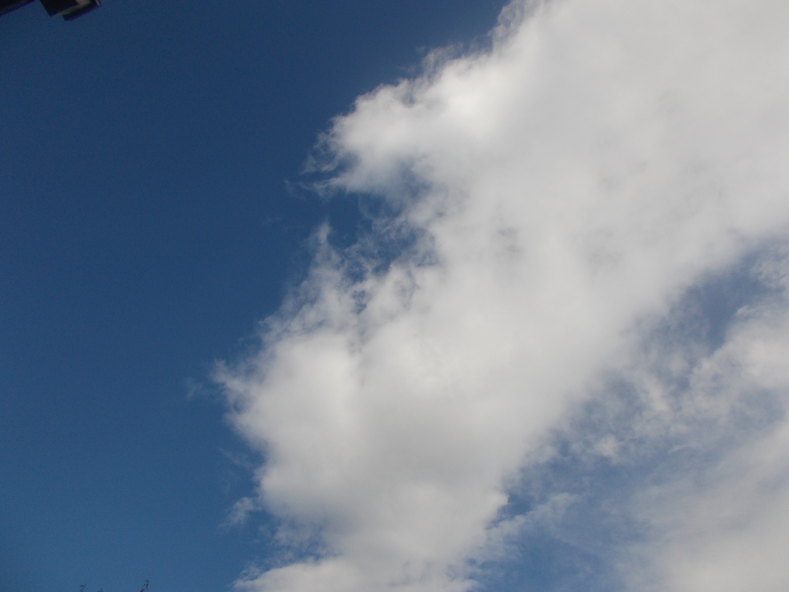

  <h1>SwayFX Dotfiles</h1>
  
<strong>A clean, Gruvbox-flavoured Wayland desktop.</strong>

  
Personal SwayFX configuration with rounded corners, subtle shadows, smooth animations, and a matching terminal, bar, and launcher.

  

    
    
    
    
  

  

---

## About

These are my personal dotfiles for a SwayFX desktop. The setup uses a warm **Gruvbox** palette, **Iosevka Nerd Font**, and a minimal layout focused on keyboard-driven workflows.

The configuration was originally put together on **Gentoo Linux**. It can be adapted to other distributions, including systems using OpenRC, runit, or dinit, but a few startup and power-management commands are distribution-specific.

## The desktop

| Component | Configuration |
| --- | --- |
| **Compositor** | SwayFX — no window borders, 5px gaps, 8px corners, shadows, 200ms animations |
| **Terminal** | Alacritty — 90% opacity, Iosevka Nerd Font, Gruvbox colours |
| **Status bar** | Waybar — workspaces, window title, media, audio, network, system stats, battery, clock, tray |
| **Application launcher** | Wofi — matching dark Gruvbox theme |
| **Font** | Iosevka Nerd Font |
| **Wallpaper** | **~/Pictures/DSCN0145.png** (included as `DSCN0145.png`) |

### Colour palette

| Role | Colour |
| --- | --- |
| Background | **#282828** |
| Secondary background | **#3c3836** |
| Foreground | **#ebdbb2** |
| Muted text | **#a89984** |
| Accent | **#d79921** |
| Green | **#a9b665** |
| Red | **#cc241d** |

## What's in the repository?

| File | Install location | Purpose |
| --- | --- | --- |
| **swayfx-config** | ~/.config/sway/config | SwayFX settings, autostart, keybindings, gaps, corners, and shadows |
| **alacritty.toml** | ~/.config/alacritty/alacritty.toml | Terminal font, opacity, and colours |
| **waybar-config.jsonc** | ~/.config/waybar/config.jsonc | Bar layout and module configuration |
| **waybar-style.css** | ~/.config/waybar/style.css | Waybar Gruvbox styling |
| **wofi-style.css** | ~/.config/wofi/style.css | Wofi launcher styling |
| **DSCN0145.png** | ~/Pictures/DSCN0145.png | Default desktop wallpaper and README preview |

## Installation

Install the dependencies listed below first. Then clone the repository:

~~~sh
git clone https://github.com/Yaffs2/swayfx-dotfiles.git
cd swayfx-dotfiles
~~~

Back up any existing configuration you want to keep, then copy the files into place:

~~~sh
mkdir -p ~/.config/sway ~/.config/alacritty ~/.config/waybar ~/.config/wofi ~/Pictures

cp swayfx-config ~/.config/sway/config
cp alacritty.toml ~/.config/alacritty/alacritty.toml
cp waybar-config.jsonc ~/.config/waybar/config.jsonc
cp waybar-style.css ~/.config/waybar/style.css
cp wofi-style.css ~/.config/wofi/style.css
cp DSCN0145.png ~/Pictures/DSCN0145.png
~~~

Log out and start a SwayFX session. If SwayFX is already running, reload the config with **Super + Shift + C**.

## Dependencies

Package names vary by distribution. Install the equivalent packages from your distro's repositories.

| Purpose | Programs / packages |
| --- | --- |
| **Desktop** | SwayFX, Waybar, Wofi, Alacritty, Thunar, swaylock, swaynag |
| **Font** | Iosevka Nerd Font |
| **Screenshots** | grim, slurp, wl-clipboard |
| **Screen recording** | wf-recorder |
| **Audio** | PipeWire with PulseAudio compatibility (pactl) or PulseAudio, pavucontrol |
| **Media keys** | playerctl |
| **Brightness** | brightnessctl and/or xbacklight |

Some Waybar modules are optional and need their own services or tools, such as MPD and power-profiles-daemon. Battery, temperature, and power-profile modules also depend on what your hardware and system provide.

## Important setup notes

Review these paths and commands before using the configuration on another system.

- **PipeWire startup:** the Sway config runs **/usr/bin/gentoo-pipewire-launcher restart**. Replace this with your distribution's PipeWire startup method, or remove the line if PipeWire is already managed by a user service.
- **Power menu:** the Waybar power menu uses **systemctl suspend** and **systemctl hibernate**. Change these actions to commands supported by your system if you do not use systemd.
- **Wallpaper:** `DSCN0145.png` is included in this repository. The installation commands copy it to **~/Pictures/DSCN0145.png**, which is the path used by the Sway config. Replace it with your own image if you prefer.
- **Waybar helper files:** the Waybar config refers to **mediaplayer.py** and **power_menu.xml** under **~/.config/waybar/**. Those helper files are not included yet. Add them yourself or remove/disable the **custom/media** and **custom/power** modules in the Waybar config.

> **Known config quirk:** the current Print screenshot binding in **swayfx-config** contains a misspelled **~/Pirctures** path. Change it to **~/Pictures** before relying on that shortcut.

## Keybindings

The modifier key is **Super** (Mod4). Most window-management actions also have Vim-style **H / J / K / L** bindings.

### Apps & session

| Shortcut | Action |
| --- | --- |
| **Super + Return** | Open Alacritty |
| **Super + D** | Open Wofi |
| **Super + E** | Open Thunar |
| **Super + L** | Lock the screen with swaylock |
| **Super + Shift + Q** | Close the focused window |
| **Super + Shift + C** | Reload the SwayFX config |
| **Super + Shift + E** | Open the exit confirmation prompt |

### Windows & workspaces

| Shortcut | Action |
| --- | --- |
| **Super + H / J / K / L** | Move focus left / down / up / right |
| **Super + Arrow keys** | Move focus |
| **Super + Shift + H / J / K / L** | Move the focused window |
| **Super + Shift + Arrow keys** | Move the focused window |
| **Super + 1–0** | Switch to workspaces 1–10 |
| **Super + Shift + 1–0** | Send the focused window to workspaces 1–10 |
| **Super + B** / **Super + V** | Split horizontally / vertically |
| **Super + S** / **Super + W** / **Super + Q** | Stacking / tabbed / toggle split layout |
| **Super + F** | Toggle fullscreen |
| **Super + Shift + Space** | Toggle floating mode |
| **Super + Space** | Switch focus between tiling and floating windows |
| **Super + A** | Focus the parent container |
| **Super + Shift + -** | Send the focused window to the scratchpad |
| **Super + -** | Show/cycle scratchpad windows |
| **Super + R** | Enter resize mode; use H/J/K/L or arrow keys, then Enter or Esc |

### Screenshots & recording

| Shortcut | Action |
| --- | --- |
| **Super + Shift + S** | Save a selected-area screenshot |
| **Super + Ctrl + S** | Copy a selected-area screenshot to the clipboard |
| **Super + Alt + R** | Start screen recording |
| **Super + Alt + S** | Stop screen recording |
| **Print** | Fullscreen screenshot (see the path note above) |

### Media & hardware keys

| Key | Action |
| --- | --- |
| **XF86AudioMute** | Toggle output mute |
| **XF86AudioLowerVolume** / **XF86AudioRaiseVolume** | Adjust output volume |
| **XF86AudioMicMute** | Toggle microphone mute |
| **XF86AudioPlay** / **XF86AudioPause** | Toggle playback |
| **XF86AudioPrev** / **XF86AudioNext** | Previous / next track |
| **XF86MonBrightnessDown** / **XF86MonBrightnessUp** | Adjust display brightness |

---

## Notes

- These are personal configuration files, not a universal installer. Review paths, commands, and optional modules before copying them over an existing setup.
- The repository includes the configuration files and `DSCN0145.png` wallpaper. The Waybar helper scripts (`mediaplayer.py` and `power_menu.xml`) are still not bundled.
